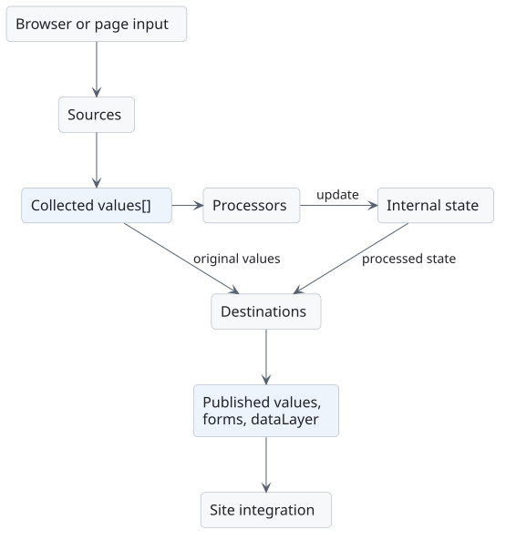
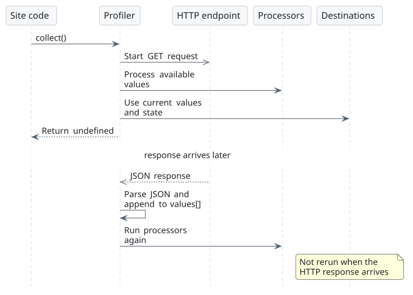

# Data pipelines

Calling `collect()` runs every configured profiler in JavaScript object-key order. For ordinary non-numeric names this is insertion order. Put a pipeline that produces a value before a pipeline that consumes it.

## Synchronous collection

For each profiler, the library performs these steps:

1. If `deferred` is enabled, check `fetchers.<profiler-name>.expire`. Skip the whole profiler while that timestamp is in the future.
2. Create an empty `values` array.
3. Call each source in array order. Each source appends zero or more inputs to that array.
4. Call each processor in array order with the collected values.
5. Call each destination in array order with the same values.

After all profilers run, remove expired entries from internal `store` and save the storage object, if `store` exists.

Processors generally write to storage; they do not replace the `values` array with their output. For example, after a `map` processor, a `datalayer_event` destination still receives the original input. Use `copy` with the mapped storage path to publish the mapped value.

Processors and destinations also run when the source list is empty or no source found a value. This supports counters, form listeners, and final selection pipelines.

## Example: explicit audience choice

For a URL containing `?audience=students`:

| Stage | Result |
| --- | --- |
| `query` source | `values` becomes `["students"]` |
| `store` processor | Writes `{ value: "students", expire: ... }` to `store.audience_param` |
| `copy` destination | Writes `students` to the separate local-storage key `audience_param` |
| Later `bestpick` destination | Chooses `audience_param` ahead of a lower-priority inferred value |

`weight` does not sort these pipelines, and `status: false` does not disable them inside this library. An integration must filter and order configuration before passing it to the constructor.

## HTTP sources

The `get` source starts an asynchronous request. `collect()` continues immediately, so the initial processors and destinations may receive an empty array or only the synchronous sources' values.

When the response arrives, `get` parses it as JSON, appends the parsed object to the existing array, and calls the profiler's processors again. It does **not** rerun destinations or resolve a promise from `collect()`.

Use a separate, later consumer pipeline or integration-controlled callback to publish fetched state. A deferred fetch pipeline skips its destinations too, so placing a `copy` destination on that same pipeline does not solve publication on subsequent calls.

Keep remote collection separate from additive processors such as `dimension` and `accumulation` unless repeated processing is intended. Mixing HTTP and synchronous sources can count the synchronous inputs again when the response arrives. Repeated calls before a response is cached can also start duplicate requests.

## Repeated collection

Each call can increase counters and dimensions, send more events, and register more form listeners. `collect()` is not an idempotent refresh operation. In a single-page application, arrange collection around deliberate navigation or interaction events and avoid attaching the same form tracker repeatedly.
